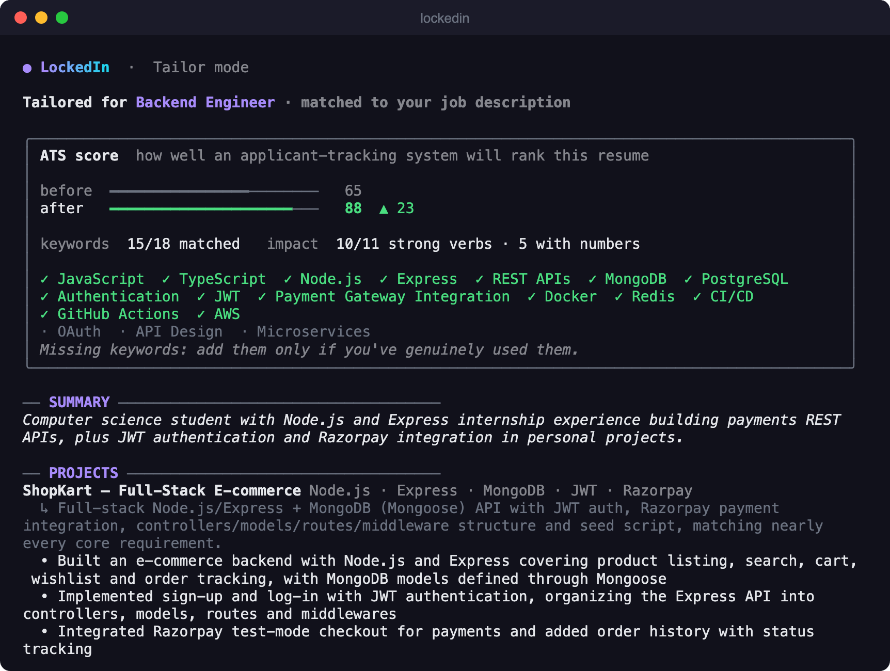
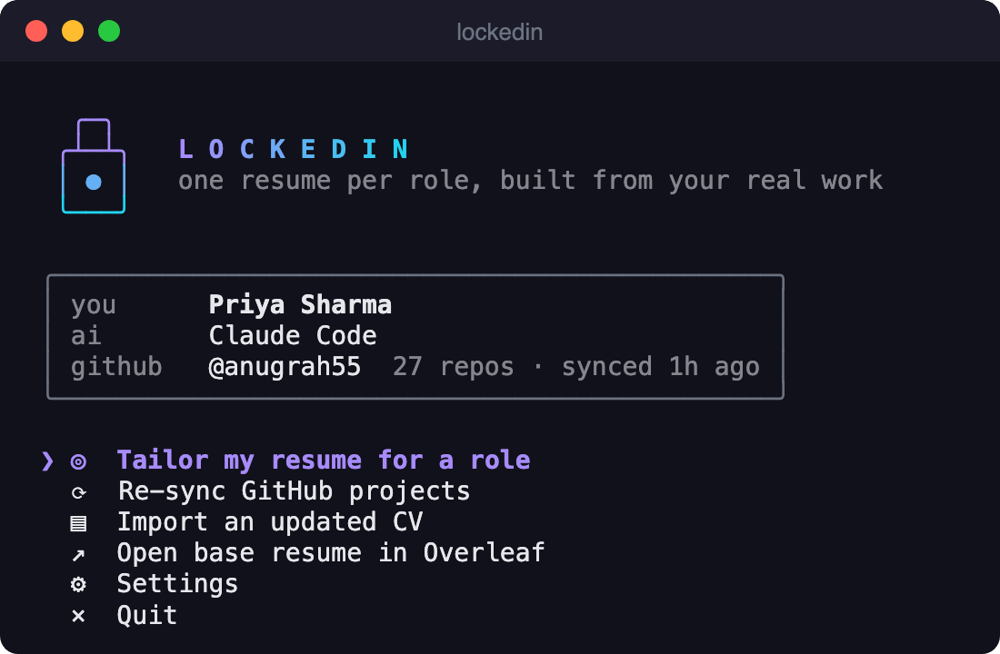
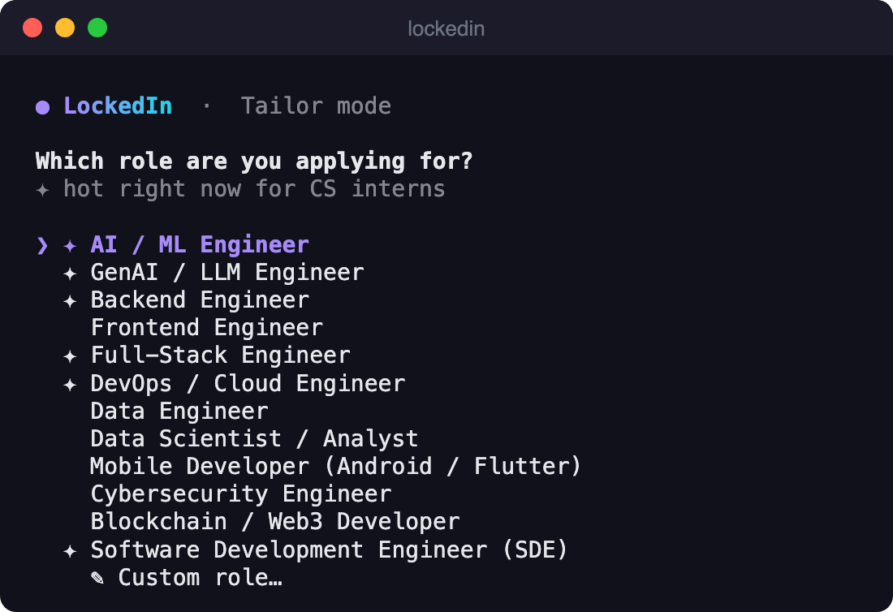
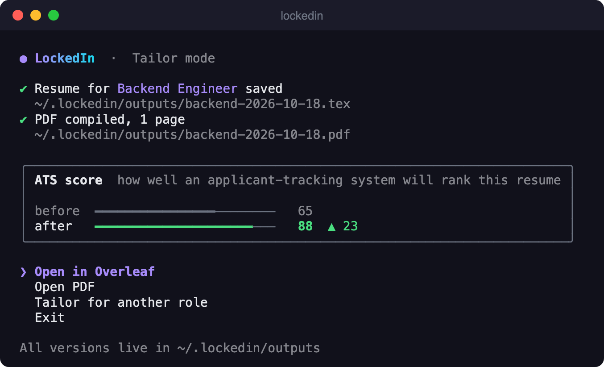
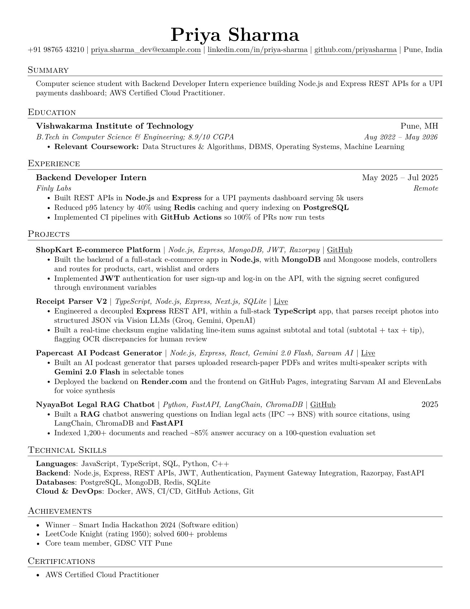
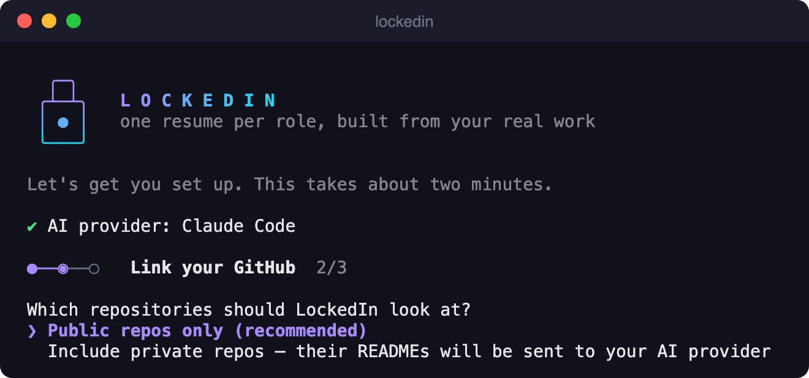

<div align="center">

# 🔒 LockedIn

**One resume per role, built from your real work.**

A terminal app that reads your GitHub and your CV, then writes a tailored, ATS-friendly LaTeX resume for every internship you apply to. It uses the Claude Code or Codex CLI you're already logged into.




</div>

---

## Why

Most students apply to AI, Backend, Frontend, DevOps and Data internships with **the same resume**, and recruiters and ATS filters notice. Tailoring by hand for every application takes hours, so nobody does it.

LockedIn does it in about a minute, using only things you've actually built.

## What it does

1. **Reads your GitHub.** Repos, languages, topics, READMEs, and pinned projects.
2. **Imports your CV** (PDF / DOCX / TXT) and turns it into a clean LaTeX resume ([Jake's Resume](https://github.com/jakegut/resume) template) that opens straight in Overleaf.
3. **Tailor mode.** Pick a role, or paste the actual job description. LockedIn then:
   - ranks your repos for that role and features the strongest 3–4;
   - rewrites your bullets around the role's keywords;
   - scores the result with an **ATS score**, before → after;
   - fits it to **one page** and saves `.tex` + `.pdf`.
4. **Never lies for you.** A deterministic **truth guard** removes any project, skill, technology or number that isn't backed by your CV or repos.

| | |
|:---:|:---:|
|  |  |
| **Home** | **Pick a role** (or paste a JD) |
|  |  |
| **Saved, compiled, scored** | **The output** (sample: fictional student, Backend role) |

---

## Installation

### 1. Prerequisites

| Requirement | Why | How |
|---|---|---|
| **Node.js 22+** | Runs LockedIn | `brew install node` or [nodejs.org](https://nodejs.org) / [nvm](https://github.com/nvm-sh/nvm) |
| **Claude Code** *or* **Codex CLI**, logged in | Does the writing. LockedIn has no API keys of its own | Claude: `npm i -g @anthropic-ai/claude-code`, then run `claude` once and log in<br>Codex: `npm i -g @openai/codex`, then `codex login` |
| **GitHub CLI** *(recommended)* | Reads your repos without you pasting a token | `brew install gh`, then `gh auth login` |
| **Tectonic** *(optional)* | Builds the PDF locally and checks it's one page | `brew install tectonic` ([other OSes](https://tectonic-typesetting.github.io/en-US/install.html)) |

No `gh`? LockedIn will ask for a [personal access token](https://github.com/settings/tokens/new?description=LockedIn&scopes=repo,read:user) instead. No Tectonic? You still get the `.tex` file and one-key **Open in Overleaf**.

### 2. Install LockedIn

```bash
git clone https://github.com/anugrah55/LockedIn.git
cd LockedIn
npm install
npm run build
npm link        # makes the `lockedin` command available everywhere
```

Check it worked:

```bash
lockedin --version
```

> **Updating:** `git pull && npm install && npm run build`. The linked command picks up changes automatically.
> **Uninstalling:** `npm unlink -g lockedin`, then delete `~/.lockedin` if you want your data gone too.

### 3. First run

```bash
lockedin
```

Setup takes about two minutes:
1. **Connect your AI.** LockedIn detects Claude Code / Codex automatically.
2. **Link GitHub.** Choose public repos only (default) or include private ones.
3. **Upload your CV.** Drag the PDF into the terminal and press enter. Check the parsed summary, and you're done.



---

## Usage

```bash
lockedin                          # home menu (or setup on first run)
lockedin tailor                   # pick a role → optionally paste the JD → review → save
lockedin tailor -r backend        # skip the role picker
lockedin tailor -r genai --jd jd.txt
lockedin sync                     # re-fetch your GitHub repos
lockedin cv ~/Downloads/cv.pdf    # re-import an updated CV
lockedin config                   # switch Claude/Codex, include/exclude private repos
lockedin roles                    # list built-in roles
lockedin where                    # show where your data lives
```

**On the review screen** you can:
- accept the draft;
- swap in different projects;
- regenerate;
- read what the truth guard removed.

**Every version is kept** in `~/.lockedin/outputs/<role>-<date>.{tex,pdf,json}`. The `.json` includes the ATS report.

### Built-in roles

✦ AI / ML Engineer · ✦ GenAI / LLM Engineer · ✦ Backend · Frontend · ✦ Full-Stack · ✦ DevOps / Cloud · Data Engineer · Data Scientist / Analyst · Mobile (Android / Flutter) · Cybersecurity · Blockchain / Web3 · ✦ SDE. You can also type any custom role.

<sub>✦ = hot for CS interns right now</sub>

---

## How it works

```
 ┌──────────┐   ┌──────────┐
 │  GitHub  │   │    CV    │   PDF / DOCX → text + hyperlinks
 └────┬─────┘   └────┬─────┘
      │ GraphQL      │ AI parse (strict JSON schema)
      ▼              ▼
   repos.json    profile.json          ← your data, stored locally in ~/.lockedin
      │              │
      └──────┬───────┘
             ▼
   ┌───────────────────┐   in parallel:  rank repos for the role
   │  analyze (AI)     │                 extract ATS keywords from the JD
   └─────────┬─────────┘
             ▼
   ┌───────────────────┐   select · reorder · reword. Never invent.
   │  tailor (AI)      │
   └─────────┬─────────┘
             ▼
   ┌───────────────────┐   drops unbacked projects, tech, skills, numbers
   │  truth guard      │   (plain code, not AI)
   └─────────┬─────────┘
             ▼
   ┌───────────────────┐   LaTeX render → Tectonic → shrink until 1 page
   │  render + ATS     │   ATS score before → after
   └─────────┬─────────┘
             ▼
     .tex · .pdf · Open in Overleaf
```

All AI calls go through **your own** `claude -p` or `codex exec`, with a strict JSON schema, no tools, and a throwaway working directory. LockedIn never sees or stores an API key.

## ATS score

| Part | Weight | What it measures |
|---|---|---|
| **Keywords** | 70 | Target keywords found in your resume. Required keywords count double. Spelling variants match ("NodeJS" = "Node.js", "Postgres" = "PostgreSQL"). |
| **Impact** | 15 | Bullets that open with a strong action verb, and bullets with real numbers. |
| **Structure** | 15 | Contact info and core sections, no first person, no overlong bullets, one page. |

Where the keywords come from:
- With a pasted **job description**, the AI extracts them from the JD.
- Without one, the role's curated keyword list is used.

The score itself is plain code, so the same resume always gets the same score. **Missing keywords are shown, never added for you.** Add them only if you've really used them.

## The truth guard

The AI may only **select, reorder and reword** what's in your CV and repos. Then plain code checks its output:

- every project must map to a real repo or CV entry;
- a technology may appear on a project only if *that* project's README, metadata or CV entry shows it;
- skills must appear somewhere in your CV or GitHub. Concrete tools count as proof of concepts: Razorpay proves "payment gateway", GitHub Actions proves "CI/CD";
- rewritten bullets can't introduce numbers that aren't in the source.

Anything that fails is removed and listed on the review screen. The guard doesn't parse technologies named inside bullet prose, which is why you always review before saving.

## Privacy

- **Data stays local:** everything lives in `~/.lockedin/` (override with `LOCKEDIN_HOME`).
- **What leaves your machine:** CV text and repo READMEs, sent to the AI provider *you* chose (Anthropic or OpenAI) via its official CLI.
- **Private repos are opt-in**, because their READMEs would be sent to your AI provider.
- **Contact details** (phone, email) are never sent during tailoring.

---

## Troubleshooting

| Problem | Fix |
|---|---|
| "LockedIn needs Claude Code or Codex" | Install one and log in: run `claude` once, or `codex login`. |
| Codex fails with `401 Unauthorized` | `codex login`, then `lockedin config` → switch provider. |
| "Couldn't find a GitHub login" | `gh auth login`, or paste a token when asked. |
| "Could not read text from this CV" | Your PDF is probably a scanned image. Export a text-based PDF from Word / Google Docs / Overleaf. |
| Parsed CV has a small mistake | Edit `~/.lockedin/profile.json` directly, or re-run `lockedin cv <file>`. |
| No PDF, only `.tex` | Install Tectonic (`brew install tectonic`), or press **Open in Overleaf**. |

## Development

```bash
npm install
npm run dev -- tailor     # run from source with tsx
npm test                  # vitest: escaping, golden LaTeX, guard, ATS, schemas, TUI
npm run typecheck
npm run smoke             # one real call to each logged-in AI CLI
npm run build             # bundle → dist/cli.js
```

```
src/
  cli.tsx            command-line entry (commander)
  app/               Ink screens: App router, onboarding steps, Tailor flow, UI kit, graphics
  ats/               keyword extraction + deterministic ATS scoring
  providers/         claude -p / codex exec adapters, strict JSON-schema output
  github/            token resolution (gh → env → PAT) + GraphQL repo fetch
  cv/                PDF/DOCX text + link extraction, AI parse → profile.json
  tailor/            roles, ranking, tailoring prompt, truth guard
  latex/             escaping + Jake's Resume renderer
  output/            Overleaf hand-off, Tectonic compile + one-page fit, saving
  schemas/           zod schemas: one source for validation and JSON schema
scripts/
  e2e.ts             headless full pipeline (CV → GitHub → rank → tailor → PDF)
  shots/             regenerate README screenshots from real app frames
```

<details>
<summary>Regenerating the screenshots</summary>

```bash
npm run build
LOCKEDIN_HOME=~/.lockedin-demo expect scripts/shots/capture.exp /tmp/shots ./jd.txt
for s in onboarding home roles review done; do
  npx tsx scripts/shots/term-shot.ts /tmp/shots/$s.log /tmp/shots/$s.svg
  scripts/shots/to-png.sh /tmp/shots/$s.svg docs/screenshots/$s.png
done
```
</details>

## Roadmap

- [ ] Cover letter and cold-email generator from the same profile
- [ ] `lockedin log`: track where you applied, and with which version
- [ ] More LaTeX templates
- [ ] GitHub OAuth device flow (no `gh` or token needed)
- [ ] Gemini CLI provider
- [ ] Publish to npm

## Credits

- Resume template: [Jake's Resume](https://github.com/jakegut/resume) by Jake Gutierrez (MIT).
- Built with [Ink](https://github.com/vadimdemedes/ink), [zod](https://zod.dev), [unpdf](https://github.com/unjs/unpdf) and [Tectonic](https://tectonic-typesetting.github.io).

## License

[MIT](LICENSE) © Anugrah
